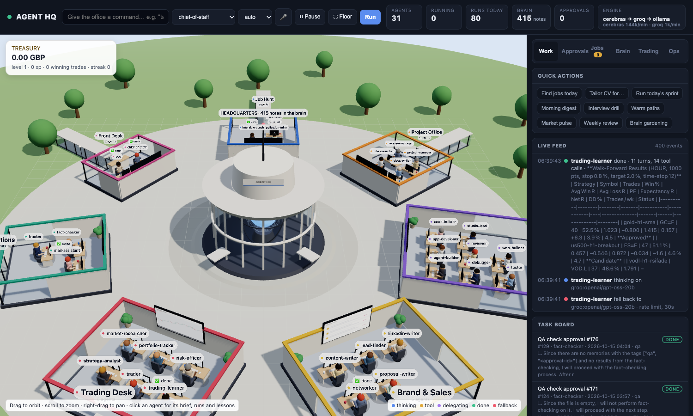
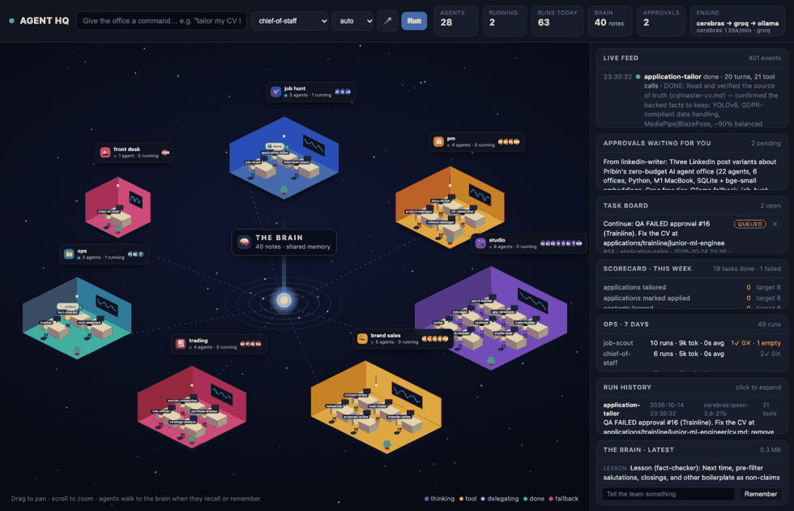

# Agent HQ

An office of 28 AI agents with one shared brain, built for zero cost, running on a 2020 MacBook.






- **Brain** (`brain/`): shared memory. Local SQLite + keyword + semantic search. Free.
- **Office** (`office/`): the agents. Run on Groq's free tier, fall back to local Ollama. Free.
- **Workspace** (`workspace/`): what the agents produce (CVs, cover letters, prep packs).

## Quick start

```bash
python3 -m venv .venv && .venv/bin/pip install -r requirements.txt
cp .env.example .env            # paste your free key from https://console.groq.com/keys
.venv/bin/python office/run.py --list
.venv/bin/python office/run.py "find 5 junior ML engineer jobs in London and tailor my CV for the best one"
.venv/bin/python office/run.py --approvals      # what is waiting for your OK
```

## Live dashboard

```bash
.venv/bin/python office/dashboard.py        # then open http://localhost:8787
```

An isometric office floating in space, one coloured room per office, drawn live on a
canvas (no art assets). Each agent sits at a desk; the monitor lights up while it thinks,
a speech bubble shows what it is doing, it walks to THE BRAIN in the centre when it
recalls or remembers, and walks to another room when it delegates. Floating cards show
"N agents · M running" per room. Drag to pan, scroll to zoom. Beside it: the live event
feed, approvals with Approve / Reject, the brain's latest memories, and a command box
that starts runs, plus a 🎤 button for voice commands (Chrome/Edge, free, in-browser), the task board, and run
history with full answers. New offices and agents appear automatically from `office/agents/`.

Talk to the **Chief of Staff** by default. It delegates to the right agents, logs what
happened in the brain, and parks anything that needs your decision in approvals.
Run a single agent with `--agent job-scout "..."`. Force local with `--engine ollama`.

## The roster (7 offices, 28 agents)

| Office      | Agents |
| ----------- | ------ |
| front-desk  | chief-of-staff: your single contact; splits commands, delegates, keeps the board, guards approvals. **coo**: oversees the office's own operations and optimises the workflow |
| job-hunt    | job-scout (LinkedIn search + fit score), application-tailor (CV + cover letter, truth-checked), interview-coach (prep packs, mocks) |
| studio      | studio-lead, agent-builder, web-builder, app-developer, code-builder, tester (never fixes), debugger (never weakens tests), reviewer (never writes) |
| brand-sales | linkedin-writer, content-writer (reels/shorts scripts), lead-finder (buyers for the productised offer), proposal-writer (pitches + quotes), networker (warm paths into target companies) |
| trading     | market-researcher (live quotes), strategy-analyst (backtests, signals), risk-officer (sizes and approves, can veto), trader (executes on the Capital.com **demo** account), portfolio-tracker. **Virtual money; the live endpoint is locked in code.** |
| ops         | tracker (job + client pipelines), mail-assistant (email drafts to `workspace/outbox/`, .ics calendar files), fact-checker (QA gate: every outgoing text is verified against the brain before approval) |
| pm          | project-manager (team leader: roadmap, daily sprint), release-manager (commits, changelog, pushes to Pribin's own GitHub), docs-writer, ml-researcher (weekly trends + project proposals) |

## The COO: oversight and self-optimisation

The `coo` agent runs an ops review every six hours, an optimisation pass at 07:00, and a deep review
on Sundays. It reads `ops_metrics` (runs, tokens and time per agent, failures, timeouts, continuations,
empty answers, fabrications caught, approval age, stuck tasks, provider budget) and acts in two ways:

- **Directly, within bounds**: `office/tuning.json` knobs (parallelism 1-4, per-run token budget,
  turn limit, budget reserve, wall-clock limit) and standing-work intervals. Every change is logged in
  the brain with its reason, and the daily pass reverts anything that made the numbers worse.
- **By proposal, with your approval**: changes to what an agent *is* (its brief) are written to
  `workspace/ops/proposals/` with a diff and the evidence, and appear in your approvals. Approve and the
  Chief of Staff applies it, keeping a backup of the old brief.

## Always working

Fixed jobs (`office/schedule.yaml`) cover the daily rhythm. Between them, `office/standing-work.yaml`
keeps every office busy: fifteen standing items (rotating job scouting, warm paths, leads, the next
roadmap milestone, nightly tests, docs refresh, research skims, content, pipeline refresh, drills,
backtests, the evening wrap-up, light gardening, code review) each with a minimum interval and an
optional time window. The scheduler runs up to `OFFICE_MAX_PARALLEL` tasks at once (default 2),
spreading them across providers that still have budget, and a budget governor pauses standing work
when a provider's daily allowance drops below 25%, so the free tiers are never exhausted by routine
work. Scheduled jobs and anything you ask for always take priority over standing work.

**Unlimited mode (on).** With `"unlimited": true` in `office/tuning.json` every agent works at once: no parallel
cap, no hourly pacing, no budget brake, and every one of the 31 agents has standing work, so none sits idle. The
only brake left is the Mac's memory: a new run waits while free memory is below `min_free_gb` (0.8 GB), and
`OFFICE_MEMORY_BRAKE=0` turns even that off. Agents borrow the dashboard's loaded search model through
`/api/embed` instead of loading their own copy, which cuts each run from about 285 MB to about 100 MB. Expect the
free engines to rate-limit under this load; runs wait for the next window or fall back as configured.

**Round the clock.** The office never idles: when nothing is queued or running, the standing item
nearest to due starts early (after at least a third of its interval). What keeps that from burning the
day's free allowance in one night-time burst is pacing: at most `standing_per_hour` standing items
(default 3, a COO knob) start per rolling hour, so roughly 70 routine runs are spread over 24 hours.
Tasks waiting for a provider's cooldown no longer block the rest of the queue. How much work a day
actually holds is set by the free tiers you connect: Groq alone is roughly one run every 20 minutes;
adding Gemini and NVIDIA keys (both free, no card) roughly triples it.

## The company: departments, heads, rhythm, hiring

`office/org.yaml` is the organisation chart: CEO Pribin; the CEO office (chief-of-staff); operations (COO); and eight
departments, each with a head, a mission and the numbers it is judged on. Every agent carries the company handbook
(`office/skills/company-handbook.md`) in its instructions: mission, structure, rhythm, the rules that never bend.

Rhythm: morning digest 08:30; approval digests 08:15 and 17:45; the Monday **board pack** (`workspace/ops/board/`,
pushed to the phone) with money, job hunt, brand, operations, the research report and the decisions waiting for the
CEO; the Sunday COO deep review; quarterly OKRs in `workspace/plan-90-days.md`.

Hiring: a new agent starts as a proposal. `propose_hire` (COO, chief-of-staff, agent-builder) writes a complete brief
with only the tools the job needs (never outward or admin tools), its department and its standing work, and asks for
approval. Approving on the dashboard installs the agent and its recurring work; it is reviewed after two weeks on
outcomes. Pribin can also drop a brief into `office/agents/` by hand.

## The Research Lab: questions nobody has answered, papers Pribin can submit

Six agents in `office: research`: the research-lead runs the pipeline; the literature-scout maps the field (arXiv and
OpenAlex, both free); the novelty-analyst finds the gap, checks it against the closest work and writes the proposal with
an experiment plan that runs on a Mac; the experimenter writes and runs the code and logs real results; the paper-writer
drafts the paper in Markdown and LaTeX; the peer-reviewer scores it like a workshop reviewer and blocks it until fixed.

Honesty is enforced in code, not prompts: `references.bib` is built only from API metadata (`bib_add`), every citation
must exist in it, and every number in the Results section must come from `experiments/results.json` written by code
that ran (`paper_check`; `paper_build` refuses otherwise). Each project lives in `workspace/research/<slug>/`; the lab
reports weekly in the board pack. A paper reaching "ready" becomes an approval: Pribin reads, edits, owns and submits.
Agents never submit anywhere. Directions: agent memory and coordination, evaluation of tool-using agents, small and
local models, vision for robotics, agent safety.

**Plagiarism guards.** `paper_check` also runs an overlap check (8-word shingles of the paper against every paper text
the lab has ever read with `paper_read`, cached under `workspace/research/.sources/`; quoted passages are exempt) and a web
quote search of the paper's most distinctive sentences. Either flag blocks `paper_build`; the writer must rewrite in its
own words or quote and cite.

## The CEO layer: from busy to profitable

The office is judged by outcomes, not activity (`office/ceo.py`):

- **Approval digest** at 08:15 and 17:45: one phone notification with everything waiting, most valuable first
  (client replies, then proposals by value, then applications by fit, posts, internal changes last). The dashboard
  and phone list approvals in the same order and say why each one matters.
- **Revenue first:** applications, proposals, leads, replies, follow-ups and referrals are claimed first; internal work
  (docs, release tidying, templates, demo apps) waits while any money task is queued.
- **Fast lead-to-proposal loop:** the lead finder looks for posts from the last 24 hours every three hours and hands
  each strong lead straight to the proposal writer, who leads with the featured package (an AI enquiry assistant for
  UK letting agents, £450) and attaches the proof in `workspace/portfolio/` (a 17-second demo video and a one-page case
  study).
- **Outcome dashboard** (Ops tab, `/api/outcomes`, the `outcome_metrics` tool for the COO and chief): applications ->
  responses -> interviews -> offers; proposals -> sent -> won -> paid; pipeline and revenue in GBP; tokens per outcome.
  Record what happened to each approved proposal in the Deals panel (sent, won, lost, paid).
- **Cheaper, better applications:** `application_pack` gives the CV tailor the master CV, a base CV for the role type and
  the cached posting in one call, with a fixed 7-step procedure; marking "I applied" starts a referral search at that company.

## Skills: current practice, kept up to date

`office/skills/` holds 13 short, dated, sourced guides to how things are done now: the UK ML job market, CVs and
screening, ML interviews, building AI agents, LLM security (OWASP Top 10 for LLM apps), modern Python, web, mobile and
desktop apps, LinkedIn, short-form video, the freelance market, UK trading rules, and testing. Each agent's brief lists
the guides for its job (`skills: [...]`) and the runtime adds them to its instructions; the LLM security guide goes to
every agent. Guides never override a brief's safety and approval rules.

Keeping them current: every two weeks the ML researcher checks the four oldest guides against fresh sources and drafts
updates with `propose_skill_update`. A draft changes nothing until you approve it on the dashboard; approving installs
it (the old version is backed up in `office/skills/.backups/`). The gate exists because guides reach every agent's
prompt, so text from the web must never flow into them unreviewed.

## Task board and "nobody stops"

Every run can be queued as a task; the scheduler runs queued tasks one at a time (Groq's free
tier dislikes parallel runs) and marks them done or failed with the result. Recurring jobs live in
`office/schedule.yaml` (daily job scan 08:00, morning digest 08:30, evening pipeline update).
The dashboard runs the scheduler while it is open; for a laptop that stays on without the
browser, run `.venv/bin/python office/scheduler.py` instead.

Approving an item on the dashboard creates a follow-up task for the Chief of Staff (log it as
applied, draft the follow-up email), so your decision feeds back into the office.

## Project management team and GitHub

`workspace/roadmap.md` lists AI projects with small milestones. Every weekday at 10:00 the
project-manager runs a sprint: pick one milestone, get it built (studio), tested, reviewed, then
the release-manager commits with a conventional message, updates the changelog and pushes to
Pribin's own GitHub (private repos by default; `git_push` refuses any other account). That is how
the GitHub graph fills up with real, tested work rather than noise. Check the repos and today's
commit count with the `github_status` tool or `gh repo list`.

## Always on

```bash
./office/launchd/install.sh        # start at login, restart on crash (macOS launch agent)
./office/launchd/install.sh off    # remove
```

Desktop notifications fire when an approval is waiting or a task finishes. Approvals on the
dashboard have a **view** button that opens the file behind them; `export_pdf` turns a tailored CV
into an A4 PDF ready to upload. The engine tile shows each provider's remaining tokens per minute.

## Strategy layer

- `workspace/plan-90-days.md`: the goal, phases, and weekly targets. The `scorecard` tool reads the
  targets and counts what actually happened (applications, contacts, proposals, posts, mock
  interviews, commits, fabrications caught). The dashboard shows it; the Chief of Staff reviews it
  every Monday and names one change for the week.
- `workspace/offer.md`: the productised freelance offer (AI back-office for a small business, three
  packages with prices). The lead-finder hunts for that buyer; the proposal-writer quotes from it.
- `workspace/roadmap.md`: AI projects with milestones, fed by the ml-researcher and shipped by the PM office.
- Daily interview drill at 07:30; weekly networking pass on Tuesdays.

## Reliability and safety layer

- **Continuations**: a run that hits its turn limit reports DONE/REMAINING and queues a follow-up task
  for the rest, so long work never dies at a limit.
- **Reflection**: after each real run the agent writes one lesson into the brain (expires after 60 days).
- **Fact-check gate**: any approval that points at a CV, letter, post or proposal automatically gets a
  fact-checker task; the approval card shows QA: PASS / EDITS / FAIL.
- **Claim guard** and **CV truth check** catch fabricated actions and skills.
- **Prompt-injection defence**: all web content is marked untrusted and instruction-like lines are
  removed; agents that browse the web never hold execution tools.
- **Eval harness** (`office/eval/`): ten tasks with known-correct behaviour, run per provider; reports
  pass rate and fabrication rate. Runs weekly; results feed the Ops panel.
- **Ops panel**: runs, tokens, time and failures per agent, provider share, last eval.

## Phone app (iOS / Android)

The office has a mobile command centre at `/m`: approvals (approve, reject, "I applied", view the
file), today's digest, the task board, the scorecard, a live feed, voice commands, and push
notifications for approvals and finished tasks. It installs as a Home Screen app (Safari: Share →
Add to Home Screen), no App Store, no Apple developer account, free.

Reach it from outside the Mac through a free tunnel; every remote request needs the
`DASHBOARD_TOKEN` from `.env` (entered once, kept as a cookie):

```bash
./office/launchd/install.sh tunnel     # Cloudflare quick tunnel as a launch agent (URL changes on restart)
./office/launchd/install.sh url        # print the current phone URL
```

For a permanent private URL use Tailscale, or a named Cloudflare tunnel on your own domain.

The quick tunnel dies when the Mac sleeps and comes back with a new address; the scheduler restarts it
and pushes the new address to the phone. For a link that never changes, set `PHONE_LINK_REPO=owner/repo`
in `.env`: the scheduler then keeps a one-page redirector on that repo's `gh-pages` branch (GitHub Pages,
free) pointing at the current tunnel, so `https://owner.github.io/repo/` always opens the office. The page
carries only the address, never the token; the dashboard still asks for the token on every new address.
See `DEPLOY.md`, which also covers running the office on a free cloud VM so it keeps working
when the Mac is off. While it runs on the Mac, the dashboard keeps the machine awake on mains power.

## The campus and the treasury

The floor is a 3D campus (Three.js, free from a CDN): one circular glass building in the spirit of Apple
Park, with a white cantilevered roof edge, oak floors and full-height glass, cut open from above. Each
department is a wing of the ring with a soft rug, wood desks facing the courtyard, desk lamps, a feature wall
of its work and a signature object: a reception counter at the Front Desk, an interview booth in Job Hunt, a
stand-up kanban table in the Project Office, bean bags in the Studio, a podcast table in Brand & Sales, live
moving charts, a ticker and a treasury trophy on the Trading Desk, and blinking server racks in Operations.

The people are motion-captured humanoids (the free Mixamo "X Bot" from the three.js examples, loaded from a
CDN): real human proportions, a captured idle and walk, and a skeleton the office poses to sit at the desk with
hands on the keyboard (typing while they work). Each wears an off-white suit trimmed in their department's
colour. If the model cannot load, the office falls back to simple built-in figures. Wall screens and the
ticker are curved to follow the building, so nothing pokes through the glass.

The shared brain is the headquarters: a glass atrium on an island in a reflecting pond, its core glowing on a
plinth with orbiting memory motes (more memories, more motes). Stone walkways and timber bridges join every
department to it. Agents really use them: an agent walks out of its doorway, along the promenade and over its
bridge to the atrium when it recalls or remembers, follows the promenade to another wing when it delegates,
then walks home. A small light travels the same route whenever a memory is written or read.

Readable by design: labels are screen-sized at any zoom, and by default only agents who are working show a
name tag (the stage's **Names** switch shows everyone). Each department's board shows live counts, for
example "2 working · 1 queued", and the Front Desk shows approvals waiting for you. **Light** switches between
golden hour and the real London time of day, with warm interiors at night. Clicking a department's board flies
into that wing, clicking an agent flies to them and opens their brief, double-click or **Overview** flies back,
and when nobody has touched the view for a while the camera glides to whoever is working.

**Design: new / classic.** The previous ring design is kept as a backup in `office/static/office3d-classic.js`
(and the git tag `design-ring-classic`). The **Design** switch on the stage flips between them and remembers
your choice; `/?design=classic` forces the old one for one visit.

The Trading Desk is the financial hub: every profitable demo trade credits the office treasury, earns
experience, lifts the office level, and showers gold over the Trading Desk while the brain flashes gold.
Losses cost credits but never experience, because losses are part of the business. The treasury, level and
streak sit top-left on the floor, on the API, and in the brain's memory.

## Trading desk: learns, validates, then trades (Capital.com demo)

The desk is built around a playbook distilled from a day-trading manual in `workspace/trading/library/`
(the full text is in the brain under namespace `trading`; drop any PDF in that folder and the learner's
`learn_document` tool reads it). The **trading-learner** agent studies it daily, and every evening runs a
strategy lab: deterministic walk-forward tests (`office/strategy.py`: SMA crossover, channel breakout, MACD,
RSI and Williams %R fades) on real hourly or daily bars, optimising on the past and scoring only on the
unseen next segment. A strategy is approved for the demo desk only if the out-of-sample result passes the
playbook's power principles (40+ trades, win rate >= 50%, profit factor >= 1.3, reward/risk >= 1.5,
drawdown <= 20%, 4+ trades a week) and at least 60% of folds were profitable. The tool refuses otherwise.

During London hours the strategy-analyst runs an hourly `signal_scan`, which applies only approved
strategies to live bars; the risk-officer checks the playbook rules; the trader executes. The rules are
enforced in code, not prompts: 1% of balance risked per trade, profit target mandatory, reward/risk >= 1.5,
five new trades a day, stop at the 3% weekly goal, stop for the day at a 2% loss, time-stops on stale
positions. Every open and close is journaled with its strategy and reason; the learner's weekly review
compares realised results with expectations and retires what fails on the evidence, changing one thing
at a time. The Trading tab shows strategies, the journal's performance report and today's limits.


**Round the clock, every market.** The desk covers 37 Capital.com demo markets (office/markets.py): 10 currency
pairs, 8 stock indices, 5 commodities, 6 cryptocurrencies and 8 shares. Two scripts do the heavy lifting with no
language model and no token cost:

- **Nightly lab sweep** (`office/trading_lab.py`, 02:00): walk-forward tests every strategy family on every
  market and writes `trading/lab-sweep.md`. It approves only what passes the same gate as before (the
  playbook's principles check and a stable out-of-sample result); near misses become candidates for the
  trading-learner. It never downgrades an approved strategy; it flags it for the learner's weekly review.
- **Hourly watch** (`office/trading_watch.py`, every hour, every day): scans every approved strategy, skips
  markets Capital reports as closed (crypto trades at weekends), proposes each fresh signal once, and only then
  wakes the risk-officer and then the trader (signals expire after two hours). Open positions get a "manage" task for the trader.

Market research runs at the London open, the New York open and the evening on weekdays, plus a daily crypto
pulse. All trading agents run on gpt-oss 120B and are marked cloud-only: they never fall back to the small
local model. Every safety rule is unchanged: DEMO only, 1% risk per trade, reward/risk at least 1.5, five trades a
day (five), the daily loss limit, and the risk-officer's approval before any order.

## Trading desk (Capital.com demo)

The trading office runs on a free Capital.com demo account: real markets, real prices, virtual money.
Keys go in `.env` (`CAPITAL_API_KEY`, `CAPITAL_IDENTIFIER`, `CAPITAL_PASSWORD`). The demo endpoint is
the default and the only one used unless `CAPITAL_LIVE=I_UNDERSTAND_REAL_MONEY` is set deliberately.

During London hours on weekdays the desk runs by itself: an hourly market pulse (researcher), a signal
scan when something moves (strategy-analyst), a risk review for every signal (risk-officer: max 10% of
balance per position, max 6 positions, stop mandatory, sector limits), execution of APPROVED decisions
only (trader, which refuses anything not backed by a risk-officer approval memory), hourly stop
management, and a 17:30 summary. The same limits are enforced in code in `office/capital.py`, so no
agent can exceed them whatever it is told.

Nothing here is financial advice; the point is a measurable, auditable paper record.

## LinkedIn posting

The linkedin-writer drafts; nothing is published until you approve. Once you approve a draft on the
dashboard or phone, either press **Post** on the variant you want, or let the Chief of Staff's follow-up
task publish the recommended one. Posting uses LinkedIn's free self-serve API (personal profile only;
company pages need LinkedIn review). One-time setup, about ten minutes: create an app at
linkedin.com/developers, add the products "Share on LinkedIn" and "Sign In with LinkedIn using OpenID
Connect", add `http://localhost:8787/linkedin/callback` as a redirect URL, put the client id and secret
in `.env`, restart, open `/linkedin/connect`. The token lasts 60 days; the phone app shows the days left.
Hard limits in code: 3,000 characters, 5 posts a day, QA-failed drafts refused.

## Email: Gmail inbox and replies

The mail-assistant reads the Gmail inbox (IMAP) and sends (SMTP) with a free App Password; no Google Cloud
project, no OAuth. One-time setup, about five minutes: turn on 2-Step Verification for the Google account,
create an App Password at myaccount.google.com/apppasswords, put `GMAIL_ADDRESS` and `GMAIL_APP_PASSWORD`
in `.env`, restart. From then on:

- Every two hours (08-21) the assistant triages unread mail, skips newsletters and automated senders, and
  answers real messages from clients, leads and recruiters with `mail_reply`.
- **Default: nothing leaves without you.** A reply or a new email becomes an approval; **Approve & send** on
  the dashboard or phone sends it from your address and marks it SENT.
- `MAIL_AUTOREPLY=1` lets replies go out immediately, but only inside an existing conversation (they wrote
  to us after we wrote to them, or their message is a reply) with a sender known in the pipeline or the brain.
  A first contact from a new address always waits for you. You get a push notification for each auto-reply.
- Hard limits in code, not prompts: real address only, never to ourselves or no-reply addresses,
  `MAIL_DAILY_CAP` (20) a day, `MAIL_BLOCKLIST`, no placeholder text, every send logged to
  `office/logs/mail_sent.jsonl` and the brain.

## Obsidian: every note the office has, in your vault

`python office/obsidian.py` (and the hourly `obsidian-sync` job) writes the office's knowledge as plain Markdown into
one folder of your vault, `Agent HQ/` (vault path: `OBSIDIAN_VAULT` in `.env`, default `~/Movies/ai employee`).
Your own notes outside that folder are never touched.

- `Brain/<kind>/` one note per memory with frontmatter (id, kind, agent, tags, created) and `[[links]]` to the
  agent and to any company, contact or project it is tagged with; brain tags become Obsidian tags
  (`#company/trainline`, `#status/applied`). Incremental: only memories changed since the last sync are rewritten.
- `Agents/` and `Departments/`: who everyone is, their tools, skill guides and instructions; each department's
  mission, head, KPIs and members.
- `Daily/<date>.md`: approvals waiting and what finished today; the approval digest and the Monday board packs.
- `Research/` the lab's proposals, literature, papers and reviews; `Pipeline/` jobs, clients, roadmap, offer, trading plan.
- **`Inbox/`: notes from you to the office.** Drop any `.md` there (optional frontmatter `kind`, `tags`,
  `importance`, `namespace`); within the hour it is stored in the brain, every agent can recall it, and the
  file moves to `Inbox/Done/`.

## October 2026 additions: browser agent, model routing, security, portable skills, traces

- **Browser agent** (`office/browser.py`, Playwright + local Chromium, free). `browser_read` returns what a real browser
  renders plus an inventory of a page's form fields; `browser_prefill` opens a job application form in a VISIBLE Chromium
  window that stays open, fills it from the application pack and Pribin's profile, attaches the CV, screenshots, and
  stops. Nothing is ever submitted by code: Pribin reviews the window and presses the site's own button. Job boards whose
  terms forbid automated applications are blocked; company career pages and applicant-tracking systems are fine.
  "Pre-fill form" button on tailored jobs in both apps. Setup: `pip install playwright && python -m playwright install chromium`.
- **Model routing by measurement.** The weekly eval's pass rate per model reorders the provider chains: a model under
  60% on three or more tasks moves behind the others. New free models in the chains: Nemotron 3.5 Lightning and
  Nemotron 3 Nano Omni (OpenRouter), Nemotron 3 Ultra and Nano 30B (Ollama Cloud).
- **Secrets never leak.** Every tool result and final answer passes `redact_secrets`: the real values of every
  `*_KEY/_SECRET/_TOKEN/_PASSWORD` in the environment and anything shaped like a credential become `[REDACTED]`.
- **Content-safety second opinion.** `mail_read` labels each inbound message with NVIDIA's free content-safety model
  (OpenRouter); a message flagged unsafe is withheld from the agent with a note for Pribin.
- **Monthly OWASP agentic audit.** The compliance officer checks the office against the OWASP Top 10 for Agentic
  Applications (guide `agentic-security-audit`) and writes `workspace/ops/security-audit-<month>.md`.
- **Portable skills.** `python office/skills_export.py` writes every guide as `skills/<slug>/SKILL.md` (Agent Skills
  format: name + description frontmatter), installable into Claude Code or any SKILL.md reader; refreshed every Friday.
- **Traces.** `/api/trace?run_id=` returns a run as an OpenTelemetry (OTLP/JSON) trace built from the event log; the
  dashboard's run history has a "Trace" button that draws the waterfall. `python office/traces.py --export` writes
  `office/logs/traces/*.json` for Phoenix or Langfuse.

## Operating it

```bash
.venv/bin/python office/run.py --doctor      # health check: providers, budget left, launch agent, brain, approvals, GitHub
.venv/bin/python office/run.py --providers   # ping each free-tier provider
./office/publish.sh                          # refresh the public portfolio repo from this one (also runs Fridays)
```

- **Free providers**: the pool knows Cerebras (now card-required), Groq, Gemini, Mistral, NVIDIA, Z.ai (GLM Flash at $0, about 1,000 requests/day), Ollama Cloud (free account, big open models), Kilo Gateway (no key at all, about 200 requests/hour, opt-in with `KILO_ENABLED=1` because it logs prompts for training), OpenRouter (":free" models, 50 requests/day), Cloudflare Workers, and optionally a self-hosted [FreeLLMAPI](https://github.com/tashfeenahmed/freellmapi) router as one more upstream. SambaNova's free tier is gone and was removed
  AI, all with free tiers that need no card at the time of writing, plus local Ollama. Paste a key into `.env`
  and the provider joins the rotation; `run.py --providers` pings each one.
- **Budget pacing**: the runtime reads each provider's rate-limit headers (per minute and per day) and
  steps a provider aside before it hits the wall, so work flows to the next free tier instead of failing.
- **Learning loop**: every real run ends with a one-line lesson; an agent's last three lessons are injected
  into its next prompt. Click any agent on the floor to see its brief, recent runs and lessons.
- **Backups**: the brain is backed up daily to `brain/data/backups/` (7 kept). Task logs and handoff notes
  are rotated automatically.
- **Eval baseline** (10 tasks, 2026-10-15): Groq 100% pass, Cerebras 90%, local Ollama 3B 60%.

## Tests

```bash
.venv/bin/python -m pytest -q tests
```

Covers the brain (recall, dedupe, namespaces, TTL, task board), the runtime (argument
sanitising, cooldown model picking, a full fake-engine tool loop, every brief's tools and
delegates), events, and the schedule logic.

## Adding an agent

Create `office/agents/<name>.md`:

```markdown
---
name: my-agent
office: studio
tier: worker            # lead = bigger model first, worker = fast model first
tools: [brain_recall, brain_remember, web_search, web_fetch, read_file, write_file]
delegates: []           # names of agents this one may hand tasks to
---
What this agent is, how it works, what it must never do.
```

Add it to a lead's `delegates:` list and it's hired.

## Models and limits: a pool of free tiers

The office does not depend on one provider. Every provider below is free, OpenAI-compatible,
and needs only a key in `.env`. The runtime tries them in order, keeps a cooldown per model,
hops to the next on a rate limit, and lands on local Ollama only when everything remote is
cooling down. On first use it asks each provider which models it actually serves, so a retired
model name can never stall a run.

| Order | Provider | Key | Free allowance (approx.) | Notes |
| ----- | -------- | --- | ------------------------ | ----- |
| 1 | Cerebras | `CEREBRAS_API_KEY` | ~60K tokens/min, 1M/day | fastest, GPT-OSS 120B + Qwen 3.8 27B |
| 2 | Groq | `GROQ_API_KEY` | ~8K tokens/min per model | GPT-OSS 120B/20B, Qwen 3.8 27B |
| 3 | Mistral | `MISTRAL_API_KEY` | ~1B tokens/month | prompts may be used for training |
| 4 | Gemini | `GEMINI_API_KEY` | ~15 req/min on Flash | good for long inputs |
| 5 | Ollama | none | unlimited, slow | `llama3.2:3b` on the Mac |

Check the pool any time:

```bash
.venv/bin/python office/run.py --providers
```

### The only model with no cap is the one on your own Mac

Every hosted free tier is metered. The one genuinely uncapped engine is Ollama on this machine, so the
office uses it as the floor, not the ceiling: workers fall back to it as soon as every cloud model is
cooling down, and with `OFFICE_LEAD_LOCAL_FALLBACK=1` lead agents do too, after waiting up to ten minutes
(`OFFICE_LEAD_WAIT_MAX`) for a cloud window. `OLLAMA_MODEL` picks the model; on an 8 GB M1, Qwen3 4B
(`qwen3:4b`, about 6 tokens/s, grounded answers, real tool calls) is the best quality that fits, and
Qwen2.5 3B or Llama 3.2 3B are faster but shallower. Expect a ten-turn run to take ten to fifteen minutes
locally and only one local run at a time; the dashboard labels every run with the model that produced it,
and nothing outgoing bypasses the approval gates whichever model wrote it.

### Free-tier realities and the guards built for them

- **~8,000 tokens per minute per model** is the binding Groq limit, not the request count. The runtime
  trims old tool results before every call, parses every wait format Groq returns, keeps a cooldown per
  model, and finishes on local Ollama after six limit hits in one run.
- **Small models fabricate.** Seen twice: skills added to a CV, and a "file saved" that was never written.
  Guards: `cv_truth_check` flags anything not in the master CV, and the runtime compares an agent's
  final answer against the tools it actually called and sends it back once if it claims an action it
  did not perform.
- **One run at a time** through the scheduler. Parallel runs just trip the per-minute limit faster.

Nothing is ever submitted, sent, posted, or paid by an agent. They prepare and
call `request_approval`; you act.

---

# The brain in detail

Everything runs on your own machine. No API keys, no quotas, no monthly fee.
The only download is a 130 MB embedding model, fetched once on first use.

## What the brain does

| Tool            | What it's for                                                            |
| --------------- | ------------------------------------------------------------------------ |
| `remember`      | Store one fact / decision / task / lesson with tags, importance, scope   |
| `recall`        | Search by meaning **and** keywords. Boosts important and recent items    |
| `update_memory` | Fix or enrich a memory instead of storing a conflicting copy             |
| `forget`        | Delete a memory                                                          |
| `recent`        | Newest memories, for a quick catch-up at the start of a shift            |
| `activity`      | Who did what in the brain (remember / recall / update / forget)          |
| `brain_stats`   | Counts per agent, kind, namespace; database size                         |
| `reindex`       | Embed older memories after enabling semantic search                      |

Under the hood: SQLite (unlimited rows, one file) + FTS5 keyword index +
local vector embeddings (`BAAI/bge-small-en-v1.5` via fastembed, CPU only).
Results from both indexes are fused, then nudged by importance and recency.

## Setup

```bash
python3 -m venv .venv
.venv/bin/pip install -r requirements.txt
```

## Try it from the terminal

```bash
.venv/bin/python brain/cli.py remember "Client prefers blue for all brand assets" --agent lead-creative --kind decision --tags client,branding --importance 5
.venv/bin/python brain/cli.py recall "what colour scheme should I use"
.venv/bin/python brain/cli.py recent
.venv/bin/python brain/cli.py stats
```

## Plug it into agents

**Claude Code** picks it up automatically from `.mcp.json` in this folder.
Open this folder in Claude Code and the `brain` tools appear.

**Claude Desktop / any MCP client**: add to the client's config

```json
{
  "mcpServers": {
    "brain": {
      "command": "/ABSOLUTE/PATH/TO/.venv/bin/python",
      "args": ["/ABSOLUTE/PATH/TO/brain/server.py"]
    }
  }
}
```

Every agent gets the same database, so one agent's `remember` is instantly
visible to every other agent's `recall`.

## How agents should use it

Put this in each agent's brief:

> Before starting a task, call `recall` with a short description of what you
> are about to do. After you finish or learn something another agent might
> need, call `remember`. One idea per memory. Always pass your agent name.

Use `namespace` to keep projects apart (`"client-acme"`, `"internal"`), and
`ttl_hours` for temporary state like "I'm working on X right now".

## Configuration

| Env var             | Default                      | Purpose                         |
| ------------------- | ---------------------------- | ------------------------------- |
| `BRAIN_DB`          | `brain/data/brain.db`        | Where the database lives        |
| `BRAIN_EMBED_MODEL` | `BAAI/bge-small-en-v1.5`     | Any fastembed-supported model   |

Back up the brain by copying `brain/data/brain.db`.
